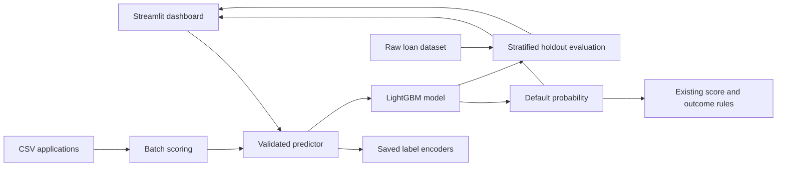

# Credit Risk Engine

**Credit risk and portfolio analytics using a saved LightGBM classifier.** The Streamlit app estimates default probabilities for individual applications and CSV batches, maps those scores to the repository's current risk bands, and evaluates the saved model on a reproducible holdout split.

This is a portfolio project for exploring model inference and analytics. It is not a production underwriting system or a substitute for validated lending policy and human review.

## What is implemented

- Single application assessment with fields and category choices taken from the saved model artifacts.
- CSV batch scoring with input schema validation and a downloadable result.
- Session scoped portfolio summaries based on scored model predictions.
- Holdout evaluation for the saved model, including ROC-AUC, precision, recall, F1, accuracy, and a confusion matrix.
- LightGBM split feature importance with a clear description of its limits.
- Probability to risk score mapping and existing rule based outcome labels.

## Verified model evaluation

The checked in model was evaluated against `data/raw/Loan_default.csv` using a stratified 80/20 train/test split with `random_state=42`. The target is `Default`, where class `1` represents default. This dataset has 255,347 rows, and the holdout has 51,070 observations.

| Metric | Saved model |
| --- | ---: |
| Accuracy | 69.39% |
| Precision | 22.71% |
| Recall | 68.03% |
| F1 score | 0.3405 |
| ROC-AUC | 0.7561 |

Confusion matrix at probability threshold 0.50, rows actual and columns predicted:

|  | Predicted no default | Predicted default |
| --- | ---: | ---: |
| Actual no default | 31,404 | 13,735 |
| Actual default | 1,896 | 4,035 |

These are evaluation results for the checked in artifact and this split, not live service measurements. They show many false positives at the default threshold. A locally trained candidate from the baseline training command reproduced the same metrics on this split. It was saved separately and did not replace the checked in inference artifact. The app labels the derived score thresholds as current code rules; no evidence in this repository establishes them as validated lending policy. No tuned model comparison is reported.

## Architecture



The Model training page runs the baseline LightGBM trainer and saves a matched model and encoder pair under `models/candidates/`, with a separate metrics JSON. It leaves the active inference artifacts unchanged. MLflow tracking is also attempted by the training script. Optuna search scripts remain available, but no tuned model comparison is reported.

## Setup

Python 3.10 or later is recommended. Dependencies are listed in `requirements.txt`.

```bash
python -m venv .venv
source .venv/bin/activate
pip install -r requirements.txt
streamlit run src/dashboard/app.py
```

The application expects these repository files:

- `models/lightgbm_credit_risk.pkl`
- `models/label_encoders.pkl`
- `data/raw/Loan_default.csv` for the Model Performance evaluation page

The prediction pages can still work without the raw dataset, but the evaluation page will show a helpful error. Artifact files must be compatible with one another and with the input columns in the dataset.

## Data and evaluation

The included data file is `data/raw/Loan_default.csv`. Its observed schema includes a `LoanID` identifier, 16 model input features, and the `Default` target. The dataset's upstream source and license are not recorded in this repository; confirm these before redistribution or commercial use.

The app recreates the stratified split configured in `src/config.py`, applies the category encoders stored with the model, then evaluates predicted probabilities at threshold 0.50. Threshold selection, calibration, subgroup performance, temporal validation, and fairness analysis are not implemented. The model has no checked in version or training timestamp metadata.

## Tests

Run the standard library test suite:

```bash
python -m unittest discover -s tests -v
```

It covers prediction schema and probability outputs, category validation, batch CSV validation, risk boundaries, and metric threshold behavior.

## Train a candidate

From the project root, use the Model training page or run:

```bash
python -m src.models.train
```

Training uses the configured raw CSV and writes candidate artifacts under `models/candidates/`. Review the candidate metrics and artifact pair before any deliberate promotion. The active model and encoder files are not overwritten by this command.

## Screenshots

No screenshots are included yet. After launching the application with real artifacts and data, useful genuine screenshots for a portfolio or LinkedIn Featured section are:

1. Executive dashboard with a scored batch in the current session.
2. Model Performance page showing the saved artifact's holdout results.
3. Single assessment with its predicted probability and separately labeled score rule.
4. Explainability page showing global split importance.
5. Batch analysis results and CSV download.

The live demo previously associated with this project is [credit-risk-engine-ai.streamlit.app](https://credit-risk-engine-ai.streamlit.app/); its current availability and version have not been verified in this repository session.

## Limitations and responsible use

- A predicted probability is not an observed default rate or a loan approval recommendation.
- Existing thresholds are hand coded application rules and are not shown to be validated or compliant policy.
- No calibration, fairness assessment, subgroup validation, temporal holdout, or monitoring is provided.
- SHAP is installed and a prior explainer module exists, but the current app does not present local SHAP explanations. Global split importance is not causal and does not explain an individual outcome.
- Metrics are tied to the evaluated saved artifact only for the duration of the evaluation; the artifact itself does not contain version metadata.
- Uploaded batch records are held in Streamlit session state for the current session and are not written by the redesigned UI to a shared input/output file.

## Project summary

Built a Streamlit credit risk analytics application around a LightGBM classifier, adding validated single and batch inference, session scoped portfolio views, and reproducible holdout evaluation. The checked in artifact achieved ROC-AUC 0.756 on a stratified 51,070 row holdout, with 68.03% recall and 22.71% precision at a 0.50 threshold. The project highlights model evaluation, inference validation, and the distinction between model estimates and decision rules.
